<h1 align="center">Kyxzz</h1>

**Founder of XOF • Backend Engineering • Infrastructure Architecture**

Building backend systems, API platforms, networking infrastructure, and automation workflows with a focus on performance, reliability, and system architecture.

---

## 🌐 Connect with Me

---

## 👨‍💻 About Me

I'm **Kyxzz**, founder of **XOF (Xyraa Official)**, an independent engineering organization focused on software engineering, backend infrastructure, networking, protocol engineering, and developer tools.

My technical interests include backend development, API architecture, networking optimization, distributed systems, automation, and system security.

I contribute to the direction and engineering development of XOF and its ecosystem of projects.

## 🏢 XOF — Xyraa Official

**XOF (Xyraa Official)** is an independent engineering organization founded by Kyxzz, with Ryyn as co-founder.

XOF focuses on:

- Backend engineering and infrastructure development.
- Networking optimization and protocol engineering.
- Developer tools and reusable software components.
- Database systems and data synchronization.
- System security, reliability, and performance.
- Developer experience and software architecture.

XOF is the organization behind its engineering ecosystem. Its projects and platforms have their own identities and purposes.

### Founders & Contributions

**Kyxzz — Founder**

Founder of XOF, contributing to the organization's engineering direction, backend infrastructure, networking optimization, database systems, and protocol development.

**Ryyn — Co-Founder**

Co-founder of XOF, contributing across the development of its projects. His work particularly focuses on **Developer Experience (DX), User Experience (UX), User Interface (UI), product design, and backend engineering**.

His contributions span product experience, system development, and implementation across the XOF ecosystem.

### XOF Official Links

| Resource | Official URL |
|---|---|
| Organization Website | [xof.web.id](https://xof.web.id) |
| GitHub Organization | [github.com/xof-next](https://github.com/xof-next) |
| npm Organization | [npmjs.com/org/xof](https://www.npmjs.com/org/xof) |
| Contact | [xyraaservice@gmail.com](mailto:xyraaservice@gmail.com) |

## 🚀 Projects & Ecosystem

### KyzzNekoo

**KyzzNekoo** is a REST API platform developed within the XOF ecosystem, providing API services and developer integrations.

It is a platform in its own right, not another name for XOF. XOF represents the engineering organization, while KyzzNekoo represents one of its platforms.

- Platform: [app.kyzznekoo.my.id](https://app.kyzznekoo.my.id)
- API: [api.kyzznekoo.my.id](https://api.kyzznekoo.my.id)

### XQuic

**XQuic** is an XOF networking and protocol engineering project exploring QUIC-based transport and HTTP/3-related technologies.

Its public Node.js interfaces include:

- `@xof/quic`
- `@xof/h3`

The project explores transport efficiency, connection handling, and networking architecture. XQuic is an engineering project built around existing networking standards, not a new Internet standard.

### @xof/* Packages

The `@xof/*` npm ecosystem contains reusable software packages and developer tools built as part of XOF's engineering work.

Organization: [npmjs.com/org/xof](https://www.npmjs.com/org/xof)

### Other Projects

XOF's wider project ecosystem also includes:

- **WANGSAF** — A communication and messaging application project.
- **Alight Motion Service Project** — An independent XOF web-service project, not affiliated with or officially associated with Alight Motion.

For current project information, refer to the [official XOF website](https://xof.web.id).

---

## 🏆 GitHub Achievements

  

  

  

---

---

---

## 🛠️ Tech Stack

### Languages & Programming

### Frontend & UI

### Backend & APIs

### Databases

### Infrastructure & DevOps

### Data Science & Machine Learning

### Design & Multimedia

### Version Control & Other Tools

---

## 🐍 Contribution Graph

## 👾 Contribution Activity

---

## 🤝 Let's Connect

Open to collaboration involving backend development, API infrastructure, networking, developer tooling, and software engineering.

### Personal Profile

### XOF — Official Organization

---

Personal profile of Kyxzz · Founder of XOF (Xyraa Official)

